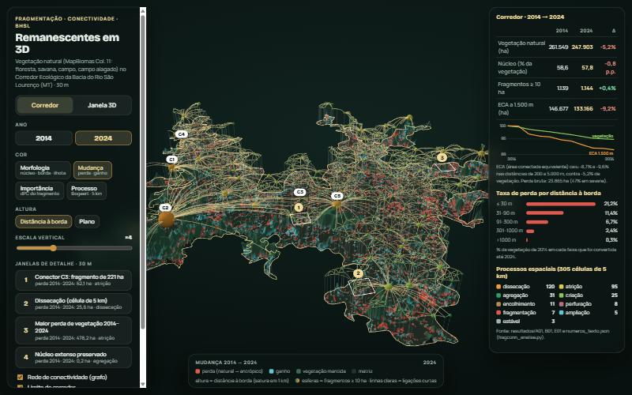
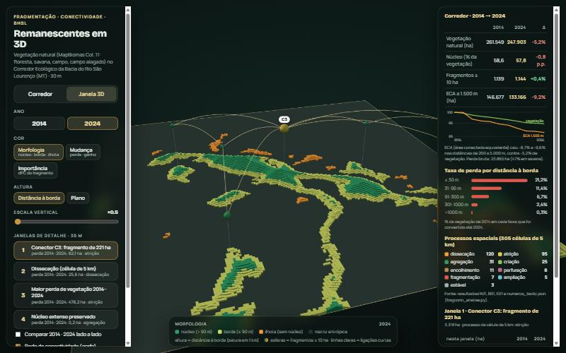
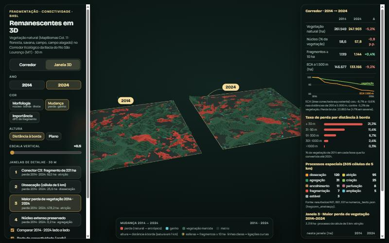

# Remanescentes em 3D · Fragmentação e conectividade no Corredor do Rio São Lourenço (MT)

Visualização 3D interativa (Three.js) da **fragmentação e da conectividade da vegetação natural** no Corredor Ecológico da Bacia do Rio São Lourenço (BHSL), Mato Grosso, Brasil, entre 2014 e 2024. Os dados de cobertura são do MapBiomas Coleção 11.

**Página:** https://bonnexd01.github.io/fragconn-3d-bhsl/







> *English summary.* Interactive 3D viewer (Three.js) of natural-vegetation fragmentation and connectivity in the São Lourenço River Basin ecological corridor (Mato Grosso, Brazil), 2014–2024, from MapBiomas Collection 11 at 30 m. It shows:
> - height = distance to the nearest anthropic edge, capped at 1 km;
> - core / edge / islet morphology;
> - conversion 2014→2024;
> - Bogaert spatial processes in 5 km cells;
> - the planar connectivity graph, with patch importance dPC at d = 1500 m.
>
> Data and analysis code: [10.5281/zenodo.24137643](https://doi.org/10.5281/zenodo.24137643). Interface in Portuguese.

## O que a página mostra

| Modo / camada | Conteúdo |
|---|---|
| **Corredor** | o corredor inteiro em blocos de 8 × 8 células (240 m). A altura é a distância média à borda (satura em 1 km): núcleos grandes viram platôs, e bordas e ilhotas ficam rentes ao chão. |
| **Cor** | **morfologia** (núcleo > 90 m da borda, borda ≤ 90 m, ilhota = fragmento sem núcleo), **mudança** 2014 → 2024 (perda e ganho), **importância** do fragmento (dPC) ou **processo espacial** de Bogaert et al. (2004) em células de 5 km. |
| **Ano** | 2014 ou 2024. |
| **Rede** | grafo planar de conectividade com fragmentos ≥ 10 ha (2014: 1.139 nós e 2.928 ligações; 2024: 1.144 e 2.938). Cada esfera é um fragmento, com tamanho ~ área e cor pela importância. Cada arco é uma ligação, mais claro quanto mais curta a distância borda a borda (probabilidade 0,5 a 1.500 m). Os rótulos C1–C5 marcam os cinco maiores conectores. |
| **Janela 3D** | quatro recortes de 192 × 192 células (5,76 km) em 30 m, mostrados em voxels: o conector C3 (fragmento de 221 ha), a célula de dissecação com maior queda de malha efetiva, a janela com maior perda e um núcleo extenso preservado. |
| **Comparar** | 2014 e 2024 lado a lado na mesma janela. |
| **Painel** | números do corredor, a série de vegetação × ECA, a taxa de perda por distância à borda e a contagem dos processos. |

Ao passar o cursor, a página mostra os valores do bloco, da célula de 30 m ou do fragmento (área, dPC intra, fluxo e conector, fração perdida). O botão **Salvar PNG** grava a vista atual.

A altura **não é altura da vegetação**: é a distância de cada pixel de vegetação natural até a matriz antrópica mais próxima, dentro do corredor.

## Principais números (lidos de `data/`)

| | 2014 | 2024 | Δ |
|---|---|---|---|
| Vegetação natural (ha) | 261.549 | 247.903 | −5,2% |
| ECA a 1.500 m (ha) | 146.677 | 133.166 | −9,2% |

- A ECA caiu de 8,7% a 9,6% nas distâncias de 200 a 5.000 m.
- A perda bruta foi de 23.865 ha, 47% dela em savana.
- 21,2% da vegetação a até 30 m da borda foi convertida, contra 0,3% a mais de 1 km.
- Os processos mais comuns nas 305 células de 5 km foram dissecação (120) e atrição (95).

## Dados (`data/`)

Todos os arquivos saem de `fragconn_analise.py`, publicado no pacote Zenodo [10.5281/zenodo.24137643](https://doi.org/10.5281/zenodo.24137643). A grade é SIRGAS 2000 / UTM 21S (EPSG:31981), 30 m.

| Arquivo | Conteúdo |
|---|---|
| `A_mapas.npz` | `m14`, `m24` (0 matriz, 1 núcleo, 2 borda, 3 ilhota), `lost`, `gain`, `inside` |
| `C_nos_2024.npz` | rótulos dos fragmentos ≥ 10 ha em 2024 e transformação afim da grade |
| `D_grid.npz` | rótulos das células de 5 km |
| `A01`, `B01` | métricas anuais e ECA/PC (200, 500, 1.500 e 5.000 m) |
| `C01`, `C02`, `C03` | dPC 2024 (intra, fluxo, conector), importância 2014 e fração perdida, cinco maiores conectores |
| `D01` | processos de Bogaert por célula de 5 km |
| `E01` | taxas de perda por distância à borda, tamanho e fisionomia |
| `numeros_texto.json`, `parametros.json` | números-síntese e parâmetros da análise |
| `CESL_V01_limite_corredor.*` | limite do corredor (EPSG:4326) |

O script refaz o grafo planar de 2014 e 2024 com a mesma regra da análise: ligações pela distância borda a borda e vizinhança de 8 para os fragmentos. Ele confere a rotulagem de 2024 com `C_nos_2024.npz` antes de gravar.

## Reconstruir a página

```bash
pip install -r requirements.txt
python scripts/exportar_visualizacao_3d_fragconn.py     # lê data/ e web/, grava docs/index.html
```

O resultado é um HTML único, de ~1 MB: os dados vão em `uint8` comprimido (zlib + base64) e o navegador descompacta com `DecompressionStream`. Para editar o visual, mexa em `web/visualizador_fragconn_3d.template.html` e rode o script de novo; não edite `docs/index.html` à mão.

## Publicar no GitHub Pages

*Settings → Pages → Build and deployment → Deploy from a branch → `main` / `docs`*

## Estrutura

```
data/      resultados da análise (npz, csv, json) e limite do corredor
docs/      página publicada (index.html gerado) e imagens do README
scripts/   exportação para a web (Python)
web/       modelo HTML/JS do visualizador (Three.js r160)
```

## Projeto irmão

[icea-canopy-3d-bhsl](https://github.com/bonnexd01/icea-canopy-3d-bhsl) mostra, no mesmo corredor e com a mesma interface, o Índice de Cobertura pela Estrutura Arbórea (ICEA) a partir de mapas globais de altura do dossel e do lidar GEDI. O visual dos dois foi inspirado em [linaq11/lidar-mangrove-canopy](https://github.com/linaq11/lidar-mangrove-canopy).

## Citação e licença

Autor: David Albuquerque Aranha ([ORCID 0009-0005-1631-1676](https://orcid.org/0009-0005-1631-1676)). Ver [`CITATION.cff`](CITATION.cff).

- Código: licença MIT ([`LICENSE`](LICENSE)).
- Dados derivados: CC BY 4.0. Os dados do MapBiomas pedem atribuição ao Projeto MapBiomas.

### Referências

- Bogaert J, Ceulemans R, Salvador-Van Eysenrode D. 2004. Decision tree algorithm for detection of spatial processes in landscape transformation. *Environmental Management* 33: 62–73. https://doi.org/10.1007/s00267-003-0027-0
- Saura S, Rubio L. 2010. A common currency for the different ways in which patches and links can contribute to habitat availability and connectivity in the landscape. *Ecography* 33: 523–537. https://doi.org/10.1111/j.1600-0587.2009.05760.x
- Souza CM Jr et al. 2020. Reconstructing three decades of land use and land cover changes in Brazilian biomes with Landsat archive and Earth Engine. *Remote Sensing* 12: 2735. https://doi.org/10.3390/rs12172735
